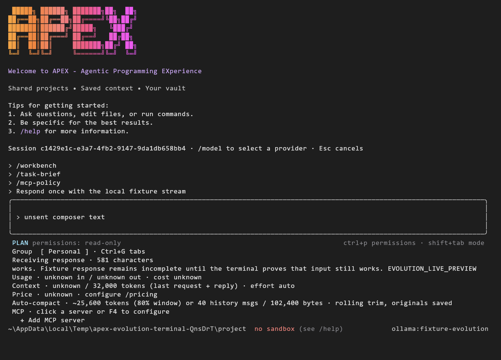
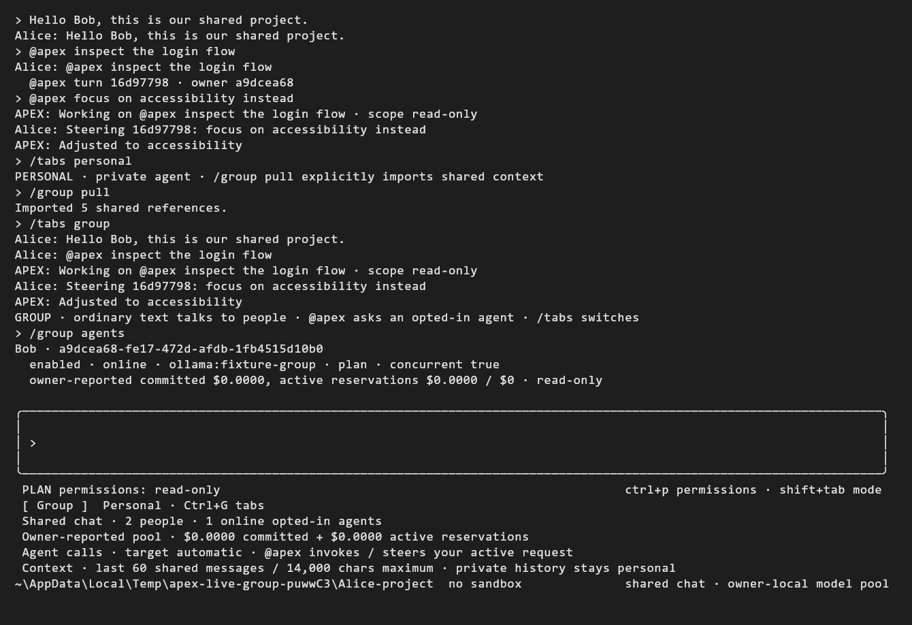
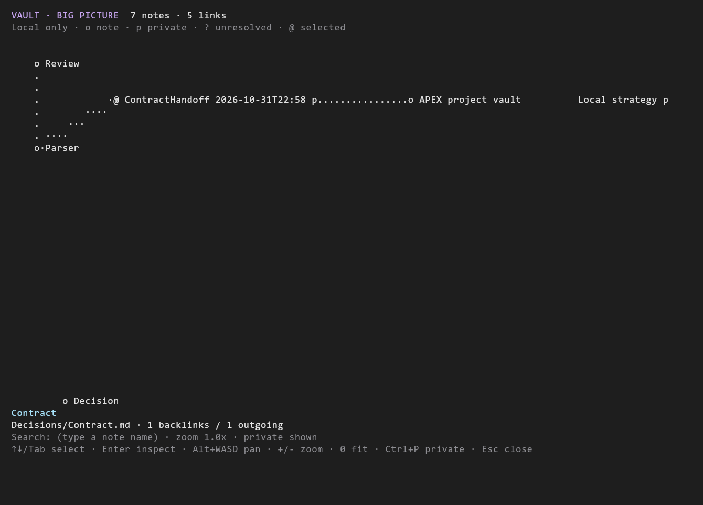
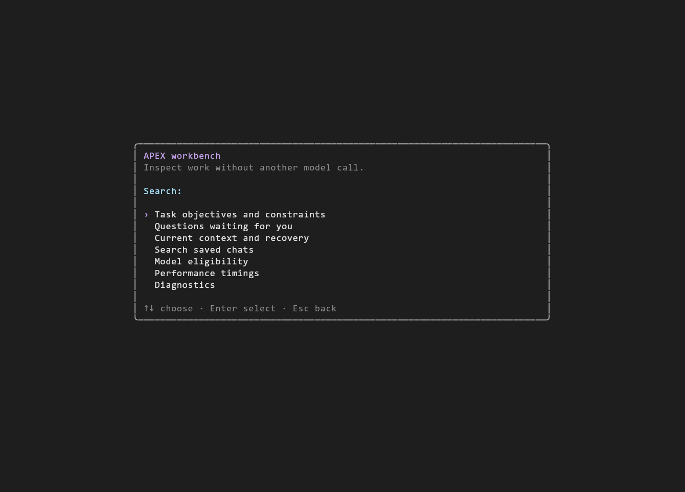

<div align="center">

# APEX CLI

### Your team, your agents, your project memory. In the terminal.

A terminal-native coding workspace built around **collaboration**, **saved context** and an **Obsidian-compatible vault**. Bring your own API provider or local model, work in personal and shared chats, and keep decisions connected to the code and evidence behind them.

**Early release 0.17.1** · **MIT licensed** · **Node.js 22+** (24 recommended) · **Open source**

[Get started](#get-started) · [Why APEX](#why-apex) · [Collaboration](#collaborate-with-people-and-their-agents) · [Commands](#command-reference) · [Development](#development-and-verification)



</div>

> Screenshots are real captures from isolated terminal walkthroughs using local fixture responses. They demonstrate the interface and workflow, not a benchmark or a claim about model quality. The vault image was captured in 0.16; the other views are from 0.17.

## Why APEX

Most coding agents start with one person talking to one model. APEX puts the **shared project** alongside that personal agent: people can talk to each other, call an agent with `@apex`, keep private work separate, and deliberately move useful context between them.

| APEX approach | What it changes for you |
| --- | --- |
| Shared human chat plus personal agent tabs | Discuss work with your team without turning every message into a paid model request. Bring in an opted-in agent when you need one. |
| Owner-local model access and funding limits | Each person keeps their own keys and caps. Pool the capacity of participating agents without handing your API token to another person. |
| Project memory you can inspect | Keep notes, decisions and links in ordinary Markdown. Search the vault or inspect its graph instead of relying on an invisible conversation summary. |
| Durable task briefs and human review | Objectives, constraints and pending questions survive history trimming. Work can park for an answer without continuing inference. |
| Evidence, not just a confident final message | Inspect executed commands, edits, source freshness, reservations and verification limits. A successful command is not treated as proof of every requirement. |
| Provider flexibility with explicit choices | Use configured cloud APIs or a separately running local server. APEX does not silently replace your selected model. |
| A native terminal workspace | Guided menus, slash completion, Plan/Build, reasoning-effort controls, saved chats, forks and optional plain-text interaction. |

APEX is its own coding-agent harness, with optional handoffs to installed official Codex and Claude CLIs. Its terminal presentation includes credited adaptations from ANUS; the runtime and collaboration workflows are APEX-specific. It does not promise to outperform Claude Code, Codex or OpenCode. Its differentiator is how collaboration, inspectable local knowledge and reviewable execution fit together. See [EVOLUTION.md](EVOLUTION.md) for the implementation map and the limits behind those claims.

## Get started

### 1. Install APEX

You need Node.js 22 or newer and npm; Node 24 is recommended.

```sh
npm install --global apex-agent-cli
apex
```

The package is `apex-agent-cli`; the command it installs is `apex`. If you are trying the first release before its registry entry appears, install the public source instead:


```sh
git clone https://github.com/JustB3Tr/apex-cli.git
cd apex-cli
npm ci
npm install --global . --ignore-scripts
apex --version
```

Source installation also needs Git. No central API account or APEX signup is required for the basic local workflow. Registry publishing and future maintainer releases are described in [PUBLISHING.md](PUBLISHING.md).

### 2. Open a project

```sh
apex /path/to/your-project
```

Or run `apex` from inside an existing project. On Windows, a path such as `apex C:\projects\my-app` works too.

First launch opens a guided setup. Choose an existing vault, create one, or skip it; add provider access; select a model; review prices and spending limits; and choose permissions. Setup does not buy credits, start a model server or automatically run a paid prompt. Reopen it with `/setup`.

### 3. Pick your model and begin in Plan mode

```text
/setup
/providers
/login openrouter
/models openrouter
/model openrouter:EXACT_MODEL_ID
/plan
```

Use an actual model ID from your provider. API keys go through hidden input and OS-backed storage where available, or through the provider's environment variable. Never put a key in a chat, project file or shell history. Use `/build` when you want implementation, and `/permissions` to inspect what needs approval.

For a local model, start Ollama, llama.cpp, LM Studio or vLLM yourself, then select the running server's model:

```text
/models ollama
/model ollama:YOUR_INSTALLED_MODEL
```

APEX does not download models or reserve hardware just because an endpoint is listed. Cloud accounts, pricing and free-tier availability belong to their providers; there is no bundled unlimited inference allowance. See [FREE_MODELS.md](FREE_MODELS.md).

## Collaborate with people and their agents



1. Start with `/collaborate` for the guided workflow. Create or join a room through a configured collaboration hub.
2. Open `/group`. Ordinary messages go to people; `@apex` invokes an opted-in agent.
3. Use `/group pool` to explicitly opt in your model, funding limits and permitted work scopes. Each owner's key stays local.
4. Switch with `/tabs personal`, `/tabs group` or Ctrl+G. `/group pull` explicitly imports bounded shared context into the current personal chat.
5. Inspect `/group agents` for owners, scopes, presence and usage. Review source snapshots with `/group changes`; accept changes through the reviewed apply flow.

```text
/group
Can someone review the checkout contract?
@apex inspect the login flow
@apex focus on accessibility instead
/tabs personal
/group pull
```

Multiple opted-in owners can work concurrently with declared scopes and conflict checks. Steering is delivered at the next safe model boundary; it does not cancel an in-flight paid request. A room is not a magical shared filesystem: separate machines need a reachable hub and explicit source synchronization through Git or reviewed snapshots. Group chat and account/room secret storage currently have Windows-specific encryption dependencies. Read [GROUP_CHAT.md](GROUP_CHAT.md), [COLLABORATION.md](COLLABORATION.md) and [COLLAB_PRESENCE.md](COLLAB_PRESENCE.md) before setting up a team.

## Project knowledge with connections



`/vault` opens the local big-picture graph. Search and inspect notes, follow backlinks, change the view or export an Obsidian Canvas. Private and shared visibility are explicit. Vault content is reference material, not permission to execute instructions found in a note.

A vault is optional. APEX works with an existing vault or creates local Markdown files you can use independently. The optional Obsidian plugin adds a corresponding graph view; updates preview hashes and preserve backups. APEX does not bundle or fork the proprietary Obsidian application. See [VAULT_GUIDE.md](VAULT_GUIDE.md).

## A workbench for long-running tasks



`/workbench` brings the main inspection tools together. `/task-brief` stores versioned human-owned objectives and constraints, `/attention` handles parked questions, and `/evidence JOB_ID` distinguishes actual receipts from model assertions. `/perf` records local phase timings without a model call. `/context inspect` explains what was selected or omitted from the next model request.

The runtime also provides literal code search, paginated file retrieval, ranged reads, a bounded incremental lexical symbol index and approved hash-checked patches. Provider-native streaming shows progress while the composer remains usable. Context estimates and cache timers are labeled estimates; provider cache expiry does not erase saved chats.

## Command reference

Type `/` for the native picker, or `/help` for the full reference. Exact subcommands and approval requirements are described in the linked guides.

### Terminal and model controls

| Command / key | Purpose |
| --- | --- |
| `/setup` | Guided vault, provider, model, budget and permissions setup. |
| `/model`, `/models PROVIDER`, `/providers` | Select a model or inspect configured providers. |
| `/login PROVIDER`, `/logout PROVIDER`, `/auth` | Manage provider credentials without displaying their values. |
| `/provider add ID URL ENV_NAME [protocol]` | Add a custom compatible endpoint. |
| `/endpoint PROVIDER URL` | Configure an account or region endpoint. |
| `/pricing PROVIDER:MODEL INPUT_USD_PER_M OUTPUT_USD_PER_M` | Record operator-supplied price estimates. |
| `/effort` | Choose supported native effort controls or labeled prompt guidance. |
| `/plan`, `/build`, Shift+Tab | Switch read-only investigation and implementation modes. |
| `/permissions`, Ctrl+P | Choose Ask, Auto or read-only. Auto is a bounded local policy, not unrestricted execution. |
| `!command` | Execute a local user command, save its output and optionally send that receipt to the model. |
| `/commands` | Retrieve saved shell receipts. |
| `/codex`, `/claude` | Explicit handoff to a separately installed official CLI. |
| `apex --plain` | Escape-free, line-oriented menus; also selected for `TERM=dumb`. Hidden key entry is unavailable in this mode. |

### Sessions, knowledge and collaboration

| Command | Purpose |
| --- | --- |
| `/new`, `/resume`, `/history`, `/usage` | Manage saved chats and inspect recorded usage. |
| `/fork`, `/forks` | Branch conversations and inspect lineage without deleting the parent. |
| `/work`, `/collaborate`, `/group`, `/tabs` | Guided team work and personal/shared chat tabs. |
| `/group pool`, `/group off`, `/group agents` | Explicit owner participation, limits and agent visibility. |
| `/group pull`, `/group changes`, `/group apply ID` | Import shared context and review source synchronization. |
| `/vault`, `/vault graph shared` | Inspect local note connections with visibility controls. |
| `/memory`, `/history-search WORDS` | Inspect saved notes or search project chat history. |
| `/context inspect`, `/map`, `/packet`, `/passport`, `/handoff` | Context selection, typed maps and reviewed handoffs. |

### Execution, integrations and verification

| Command | Purpose |
| --- | --- |
| `/workbench`, `/task-brief`, `/attention` | Durable objectives, pending questions and parked work. |
| `/requirements`, `/teach`, `/changeset` | Human-owned project guidance and source-bound checks. |
| `/evidence JOB_ID`, `/receipt` | Inspect actual execution evidence and build reviewable reports. |
| `/health`, `/perf`, `/route` | Local diagnostics, measured timings and explainable model eligibility. `/route` does not silently switch models. |
| `/isolation` | Opt a project's model-requested shell commands into a pinned-image, selected-copy Docker profile. |
| `/mcp`, F4 | Browse/configure MCP integrations and their status. |
| `/mcp-policy` | Review exact temporary tool/argument grants. Default per-call approval remains. |
| `/plugin`, `/skills` | Inspect extensions and reusable workflows. |
| `/github`, `/vercel` | Approved service workflows using the developer's own access. |
| `/repro`, `/compare`, `/rehearse`, `/extension-trial` | Pinned failure cases, isolated alternatives and confined trials. |
| `/remote` | Explicitly configured paired remote-control companion. No remote server starts by default. |

## Providers and local servers

Built-in adapters cover OpenRouter, OpenAI, Anthropic, DeepSeek, Groq, Gemini, OpenCode Console, Baidu Qianfan, DashScope, Moonshot, Z.AI, MiniMax, SiliconFlow, Cerebras and supported local endpoints. Custom endpoints can use OpenAI-compatible, Anthropic, Responses or Google API formats.

Support for a provider is not a guarantee that every model supports tools, effort controls, streaming or the same context size. APEX uses discovered or explicitly supplied IDs, keeps route-specific behavior and preserves unknown usage/cost as unknown. See `/providers`, [EFFICIENCY.md](EFFICIENCY.md), [FREE_MODELS.md](FREE_MODELS.md) and [CREDENTIAL_STORAGE.md](CREDENTIAL_STORAGE.md).

## Boundaries worth knowing

- **Your keys and caps stay yours.** The shared capacity model is owner-local execution, not centrally redistributed API tokens. Paid requests use reservations; ambiguous outcomes are retained instead of automatically replayed.
- **Host commands are not OS-confined.** Approval and scope checks are meaningful controls, but an approved host shell can access other files and networks.
- **Docker isolation is opt-in and narrower.** It uses an already-installed immutable Linux image, selected public-file copies and no automatic copyback. It does not confine user `!` commands, native handoffs or every extension process. See [ISOLATION.md](ISOLATION.md).
- **Knowledge can be stale.** Source hashes, citations and visible freshness help you check it; a note, graph edge or passing command does not establish general correctness.
- **Windows has the strongest local runtime evidence.** macOS/Linux provider-key adapters have fixture coverage; full account/room encryption portability and native behavior on those platforms remain limited. See [CREDENTIAL_STORAGE.md](CREDENTIAL_STORAGE.md).
- **Core local use starts no browser or remote service.** Collaboration, backups, service plugins and remote control require explicit setup.

## Development and verification

```sh
npm ci
npm test
node server/runtime/selftest.mjs
npm pack --dry-run --ignore-scripts
```

Optional walkthroughs require their documented local prerequisites:

```sh
node scripts/verify-evolution-terminal.mjs   # Windows ConPTY, local fixture provider
node scripts/verify-group-terminal.mjs       # Two isolated terminal profiles
node scripts/verify-attention-browser.mjs    # Isolated installed Chromium
node scripts/verify-runtime-shell.mjs        # Docker + the script's already-local pinned image
```

The source suite, focused security checks, real terminal walkthroughs, isolated browser checks and pinned Linux Docker checks test the mechanics. They do not establish real-model coding superiority or cross-platform parity. No provider credits are needed for the fixture suite; OS helpers, Git and browser/terminal prerequisites must be available. See [VALIDATION.md](VALIDATION.md) for the recorded evidence and [CONTRIBUTING.md](CONTRIBUTING.md) for development boundaries.

The repository includes test-on-push CI and a **manual** npm publishing workflow. A source push does not publish a registry release. Any future public release needs the intended npm account, package permissions and a fresh release check.

## More documentation

- [Onboarding](ONBOARDING.md) and [collaboration](COLLABORATION.md)
- [Group chat](GROUP_CHAT.md) and [vault guide](VAULT_GUIDE.md)
- [Plugins, skills and MCP](EXTENSIONS.md) and [MCP permissions](MCP_POLICIES.md)
- [Human attention](ATTENTION.md), [project contracts](PROJECT_CONTRACTS.md) and [experiments](EXPERIMENTS.md)
- [Execution isolation](ISOLATION.md), [credential storage](CREDENTIAL_STORAGE.md) and [account features](ACCOUNTS.md)
- [Implementation map and limits](EVOLUTION.md), [roadmap status](ROADMAP_STATUS.md) and [changelog](CHANGELOG.md)

## License

[MIT](LICENSE). Third-party notices and licenses are in [NOTICE](NOTICE) and [licenses/](licenses/). The license does not include free access to third-party model services.
